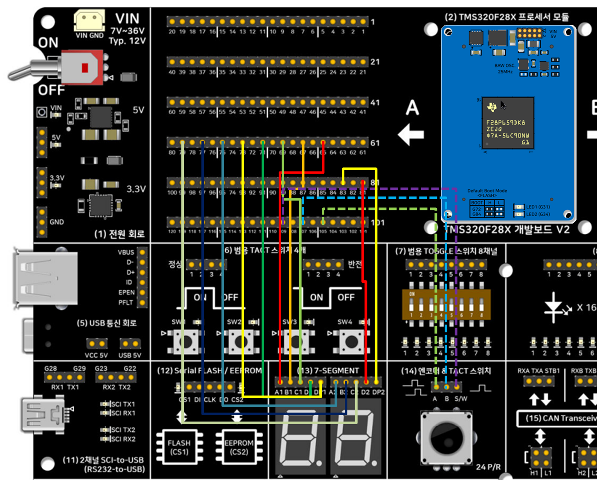

# 엔코더(eQEP)로 7-세그먼트 00~99 카운터 — TMS320F28P65x DriverLib 버전

**요약**
- 개발보드 V2의 **(14) 로터리 엔코더(24P/R)** 를 칩의 **eQEP1** 로 읽어서 **(13) 7-세그먼트 2개** 에 **00~99** 로 표시합니다. 오른쪽으로 돌리면 +1, 왼쪽으로 돌리면 -1, 노브를 누르면 00으로 리셋되고 누르는 동안 점(DP)이 켜집니다.
- **TI DriverLib**(`GPIO_*`, `EQEP_*`)으로 만들었고 SysConfig는 쓰지 않습니다. 값 계산과 출력 워드 만들기는 칩과 무관한 순수 C 모듈 `seg_counter.c/.h`가 맡아서 [비트필드](../13_14_SevenSeg_Encoder_Bitfield/)·[FreeRTOS](../13_14_SevenSeg_Encoder_Freertos/) 버전과 똑같이 공유하고, PC에서 gcc로 단위 시험도 합니다(`test/host`).
- **보드에서는 아직 확인하지 않았습니다**(빌드와 PC 테스트만 확인). 확인 범위는 6번 항목을 보세요.

## 1. 하드웨어 배선

개발보드 **A Side 핀-헤더** 에 점퍼선 13개로 연결합니다.

### 1.1 (13) 7-세그먼트 신호 입력 핀-헤더

매뉴얼의 표 20-1처럼 자리마다 BCD 4핀(A가 LSB)과 DP 1핀을 넣습니다. 보드의 CD4543B가 값을 유지해 주므로 다이내믹 스캔은 필요 없습니다. 핀-헤더는 `A1 B1 C1 D1 DP1 A2 B2 C2 D2 DP2` 순서이고, GPIO0~9도 같은 순서라 점퍼선이 나란히 들어갑니다.

| (13) 헤더 핀 | 의미 | GPIO | A-Side 핀 |
|---|---|---|---|
| A1 / B1 / C1 / D1 | 1번 자리(왼쪽, 십의 자리) BCD, A = LSB | GPIO0 / 1 / 2 / 3 | 65 / 67 / 69 / 71번 |
| DP1 | 1번 자리 점 (High = 켜짐) | GPIO4 | 73번 |
| A2 / B2 / C2 / D2 | 2번 자리(오른쪽, 일의 자리) BCD | GPIO5 / 6 / 7 / 8 | 75 / 77 / 79 / 81번 |
| DP2 | 2번 자리 점 | GPIO9 | 83번 |

### 1.2 (14) 엔코더 & TACT 스위치 신호 출력 핀-헤더

핀-헤더는 `A  B  S/W` 3핀입니다.

| (14) 헤더 핀 | 의미 | GPIO | A-Side 핀 |
|---|---|---|---|
| A | 엔코더 A상 | GPIO20 (eQEP1 QEPA, MUX 1) | 105번 |
| B | 엔코더 B상 | GPIO21 (eQEP1 QEPB, MUX 1) | 107번 |
| S/W | 노브 스위치 (누르면 High) | GPIO22 (일반 입력) | 109번 |

- 엔코더 A/B는 보드에서 슈미트 트리거 버퍼를 거쳐 나오고, 노브 스위치는 10k 풀다운 회로입니다. 그래서 세 입력 모두 칩 내부 풀업을 켜지 않습니다.
- GPIO20/21은 TI의 eQEP 예제(`eqep_ex2_pos_speed`)와 같은 핀입니다.

### 1.3 연결도



실선 10가닥이 (13) 7-세그먼트(A Side 65~83번 홀수 핀 → `A1 … DP2` 순서), 점선 3가닥이 (14) 엔코더(A Side 105번 → `A`, 107번 → `B`, 109번 → `S/W`)입니다. 두 헤더 모두 핀 순서대로 나란히 꽂으면 됩니다.

## 2. 동작

- 엔코더 눈금 하나(=펄스 1개)를 돌릴 때마다 표시 값이 1씩 바뀝니다. eQEP는 쿼드러처 모드에서 A/B 네 에지를 모두 세므로(x4) 눈금 하나 = 위치 카운터 4입니다.
- 00에서 더 줄이거나 99에서 더 늘려도 넘치지 않고 멈춥니다.
- 노브를 누르는 순간(안 눌림 → 눌림) 00으로 리셋되고, 누르고 있는 동안 DP 두 개가 켜집니다.
- 10 ms 주기로 위치 카운터와 스위치를 읽습니다. 주기 안에 눈금 여러 개를 돌려도 놓치지 않고, 눈금보다 작게 돌린 카운트는 다음 주기로 넘겨서 누적합니다.
- 노브를 한 칸 돌렸는데 값이 2씩 바뀌거나 반 칸마다 바뀌면 `seg_counter.h`의 `SEGCNT_COUNTS_PER_STEP`(기본 4)을 바꾸세요. 오른쪽으로 돌렸는데 값이 줄면 A/B를 바꿔 연결하거나 `initEqep1()`의 `EQEP_CONFIG_NO_SWAP`을 `EQEP_CONFIG_SWAP`으로 바꾸세요.

CCS Expressions 창에 `displayValue`(표시 값), `encoderPos`(위치 카운터), `knobPressed`, `segOutput`(GPIO0~9 출력 워드)을 등록하면 실시간으로 볼 수 있습니다.

## 3. 소프트웨어 구조

| 파일 | 역할 |
|---|---|
| `13_14_SevenSeg_Encoder_Driverlib.c` | 초기화(GPIO, eQEP1)와 10 ms 폴링 루프 |
| `seg_counter.c/.h` | 위치 → 00~99 값 환산(눈금 단위, 32비트 카운터 한 바퀴 처리), 스위치 에지 검출, 7-세그먼트 출력 워드 변환. 레지스터를 건드리지 않는 순수 C |
| `test/host/test_seg_counter.c` | `seg_counter`의 PC 단위 시험 |

7-세그먼트 출력 워드의 비트 n이 GPIOn에 그대로 대응합니다(비트0~3 = 1번 자리 A~D, 비트4 = DP1, 비트5~8 = 2번 자리 A~D, 비트9 = DP2). 출력은 `GPIO_setPortPins` / `GPIO_clearPortPins`로 GPIO0~9만 바꿉니다.

## 4. 소프트웨어 버전

CCS 21.x / **SysConfig 미사용** / C2000Ware 26.00.00.00 driverlib(로컬 복사) / CGT 22.6.3.LTS.
`device.h`/`device.c`/`driverlib.h`/driverlib 헤더 전체/`driverlib.lib`를 프로젝트 폴더 안에 복사해 두었으므로 C2000Ware 설치 경로와 무관하게 빌드됩니다. CCS에서 `CCS/13_14_SevenSeg_Encoder_Driverlib.projectspec`을 Import하세요.

## 5. PC 단위 시험

```
cd test/host
gcc -Wall -Wextra -I../.. test_seg_counter.c ../../seg_counter.c -o test_seg_counter
./test_seg_counter
```

표시 값 범위 제한, 눈금 환산과 남은 카운트 누적, 카운터 한 바퀴 넘어감, 스위치 에지, 출력 워드 비트 배치를 확인합니다(34개 항목 통과).

## 6. 검증 상태

- **빌드·PC 테스트로 확인함(2026-10-14)**: CPU1_RAM, CPU1_FLASH 구성이 모두 오류 없이 컴파일·링크되고, `seg_counter`의 PC 테스트가 통과합니다.
- **보드에서 확인 전**: 엔코더 회전 방향(+/-)과 눈금당 카운트(4), 노브 스위치 리셋, DP 점등, 7-세그먼트 자리 대응(1번 자리 = 왼쪽).

## 7. 메모리 사용량

링커 맵의 영역별 사용량 합계(워드, 16비트)입니다. `--opt_level=off`, CGT 25.11.1.LTS로 측정했습니다.

| | CPU1_RAM 구성 합계 | CPU1_FLASH 구성 — Flash | CPU1_FLASH 구성 — RAM |
|---|---|---|---|
| DriverLib | 5,721 | 5,166 | 1,267 |

세 버전 비교는 [FreeRTOS 버전 README](../13_14_SevenSeg_Encoder_Freertos/README.md)에 있습니다.
